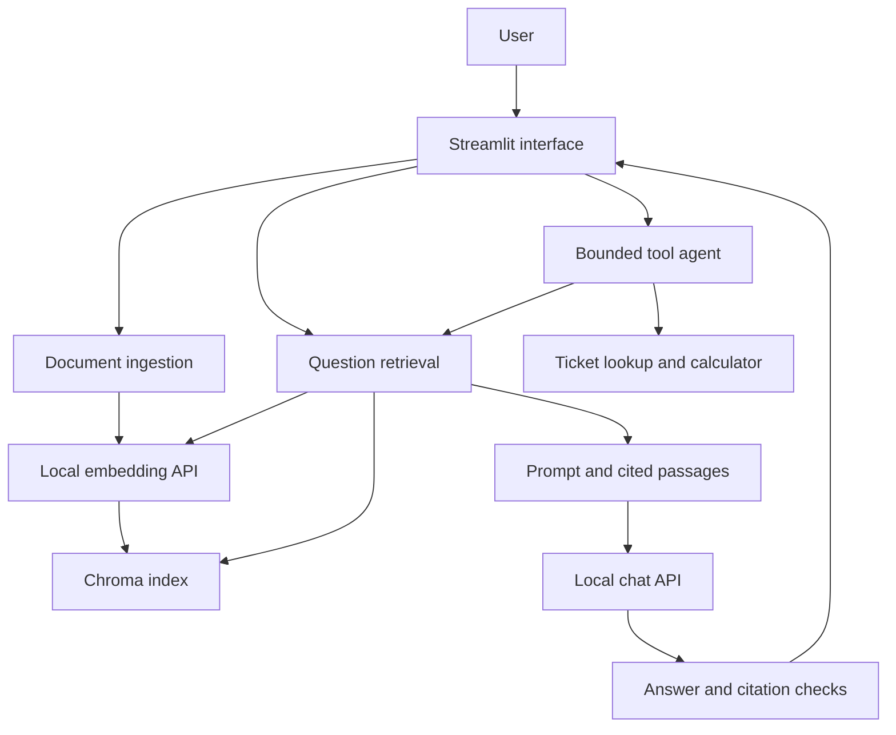

# System architecture

The shared client provides caching, request retries and usage metrics. The separate framework
exercise uses LangChain integrations for comparison. Chroma and SQLite persist on local disk.
The model server and UI should remain private. No real email, account update or external
customer-system write is implemented.
